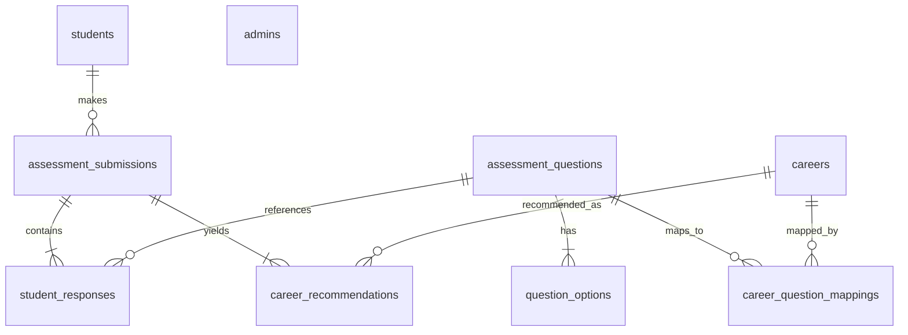

# Career Recommendation System for B.Tech CSE Students

A complete, production-ready, professional Java Web Application built specifically for undergraduate Computer Science & Engineering students to discover their optimal career pathways through a structured 20-topic assessment and a transparent, deterministic recommendation engine.

Built using traditional Java web technologies—**Core Java, Java Servlets, JSP, JDBC, and MySQL**—running on **Apache Tomcat** with **no Maven, no Gradle, and no external application frameworks**.

---

## Table of Contents
1. [Project Overview & Objectives](#1-project-overview--objectives)
2. [Features & User Roles](#2-features--user-roles)
3. [Technology Stack](#3-technology-stack)
4. [Software Prerequisites](#4-software-prerequisites)
5. [Compatible Software Versions](#5-compatible-software-versions)
6. [VS Code Setup & Recommended Extensions](#6-vs-code-setup--recommended-extensions)
7. [Downloading & Installing Apache Tomcat](#7-downloading--installing-apache-tomcat)
8. [MySQL Connector/J JDBC Driver](#8-mysql-connectorj-jdbc-driver)
9. [Database Installation & Setup](#9-database-installation--setup)
10. [Database Connectivity Configuration](#10-database-connectivity-configuration)
11. [Compiling the Application Without Maven](#11-compiling-the-application-without-maven)
12. [Deploying to Apache Tomcat](#12-deploying-to-apache-tomcat)
13. [Starting Tomcat & Accessing the Application](#13-starting-tomcat--accessing-the-application)
14. [Student User Guide: Registration to Results](#14-student-user-guide-registration-to-results)
15. [Admin User Guide: Setup & Portal Management](#15-admin-user-guide-setup--portal-management)
16. [Troubleshooting Common Errors](#16-troubleshooting-common-errors)
17. [Database Schema & Table Descriptions](#17-database-schema--table-descriptions)
18. [Recommendation Algorithm & Formula (With Worked Example)](#18-recommendation-algorithm--formula-with-worked-example)
19. [Project Architecture & Key Classes](#19-project-architecture--key-classes)
20. [Suggested Viva Questions & Answers](#20-suggested-viva-questions--answers)
21. [Limitations & Future Enhancements](#21-limitations--future-enhancements)

---

## 1. Project Overview & Objectives

B.Tech Computer Science & Engineering students are often overwhelmed by the vast array of career avenues—from Software Development and Frontend Engineering to DevOps, Machine Learning, Cybersecurity, Cloud Engineering, and Product Management.

### Key Objectives:
- **Interest-Based Discovery**: Evaluate student preferences through 20 clear, beginner-friendly technical interest topics rather than high-stress coding puzzles or subjective aptitude tests.
- **Explainable & Deterministic Recommendations**: Implement a deterministic Core Java algorithm that calculates compatibility scores across 35 seeded CSE career paths and explains *why* each career was matched.
- **Robust Security**: Enforce salted PBKDF2 SHA-256 password hashing, session fixation countermeasures, CSRF validation, and server-side role-based access control.
- **Beginner-Friendly Architecture**: Built with standard Servlets and JSP using standard `javac` commands, making it ideal for college viva examinations and learning foundational Java web concepts.

---

## 2. Features & User Roles

### A. Student Features
- **Registration & Authentication**: Safe account registration storing college name, degree (defaulting to B.Tech CSE), and current year (1–4) with email uniqueness.
- **Student Dashboard**: Real-time stats showing completed assessments, latest recommendation summary, and quick action cards.
- **20-Question Career Assessment**: Mobile-friendly, 1-at-a-time stepped interface with progress indicators, radio cards, previous/next controls, and modal confirmation before submission.
- **Top 5 Career Matches**: Displays the five highest-scoring career paths with match scores, descriptions, required skills, recommended tools, and personalized match explanations.
- **Career Roadmap Viewer**: In-depth view of typical day-to-day responsibilities, industry skillsets, tools to learn, and beginner next-step recommendations.
- **Assessment History**: Audit log of past assessment submissions allowing students to review earlier results and track shifting interests.
- **Academic Profile Management**: Update enrolled details or change passwords securely.
- **Printable Report**: Dedicated CSS print styles (`window.print()`) that neatly format career results for printing or PDF export.

### B. Administrator Features
- **Admin Authentication**: Isolated admin login authenticated against the MySQL database.
- **Admin Dashboard**: Live database metrics: total students, total submissions, total active questions, and total careers.
- **20-Question Integrity Sentinel**: Displays an administrative warning banner if active questions deviate from the mandatory count of 20, pausing new assessments until exactly 20 are active.
- **Question Management**: Add questions, edit wording and 4 option labels, soft-deactivate/activate questions, and set display order.
- **Student Directory & Auditing**: Search students by name or email, view academic details, and inspect completed assessment dates.
- **Student Response Viewer**: Audit a student's responses to all 20 questions (displaying text snapshot, selected option, and numerical rating 1–4) alongside generated top recommendations.
- **Career Catalog (35 Careers)**: Review and update descriptions, responsibilities, skills, tools, and question weights.

---

## 3. Technology Stack

- **Frontend**: Semantic HTML5, Modern Responsive CSS3 (CSS Variables, Flexbox/Grid, Mobile-first), and Vanilla JavaScript ES6+.
- **Backend**: Core Java (JDK 11, 17, or 21 compatible), Java Servlets 3.1 (`javax.servlet`), and JavaServer Pages (JSP).
- **Database**: MySQL Server 8.0 with InnoDB engine and UTF-8 encoding (`career_recommendation_system`).
- **JDBC Driver**: MySQL Connector/J 8.3.0 Type-4 JDBC Driver.
- **Web Server**: Apache Tomcat 9.0 (native `javax.servlet` support).
- **IDE**: Visual Studio Code (with Coding Pack for Java).
- **Build / Packaging**: Vanilla `javac` and batch/shell compilation scripts. **No Maven or Gradle required.**

---

## 4. Software Prerequisites

Before running the application, ensure the following software is installed on your computer:
1. **Java Development Kit (JDK)**: JDK 11, 17, or 21 (Oracle JDK, OpenJDK, or Eclipse Temurin).
2. **MySQL Server**: MySQL Community Server 8.0+ running on port `3306`.
3. **Apache Tomcat**: Apache Tomcat 9.0.x (zip or Windows installer).
4. **Visual Studio Code**: Latest stable build.
5. **Git** (optional): For version control.

---

## 5. Compatible Software Versions

| Component | Recommended Version | Minimum Supported |
|---|---|---|
| Java JDK | JDK 17 LTS / JDK 21 LTS | JDK 11 LTS |
| Apache Tomcat | Tomcat 9.0.80+ / 9.0.121 | Tomcat 9.0.x |
| MySQL Server | MySQL Community 8.0.x | MySQL 5.7 / 8.0 |
| MySQL Connector/J | 8.3.0 / 8.0.x | 8.0.28+ |
| Servlet Specification | Servlet 3.1 (`javax.servlet.*`) | Servlet 3.0 |

> **Note on Tomcat 10+**: Tomcat 10 switched packages from `javax.servlet` to `jakarta.servlet`. This project uses `javax.servlet`, making **Apache Tomcat 9** the ideal and straightforward target.

---

## 6. VS Code Setup & Recommended Extensions

To develop and test in Visual Studio Code:
1. Download and install **Visual Studio Code** from [code.visualstudio.com](https://code.visualstudio.com/).
2. Open VS Code and open the Extensions panel (`Ctrl + Shift + X`).
3. Install the following recommended extensions:
   - **Extension Pack for Java** (Microsoft): Provides language support, IntelliSense, and debugging.
   - **Tomcat for Java** (Community / Microsoft): Allows starting and stopping Tomcat directly from the VS Code sidebar.
   - **MySQL** (cweijan): Optional database explorer inside VS Code.
4. Open the project folder in VS Code:
   ```cmd
   code c:\Users\hp\OneDrive\Desktop\CareerRecommendationSystem
   ```

---

## 7. Downloading & Installing Apache Tomcat

1. Visit the official Apache Tomcat 9 download page: [tomcat.apache.org/download-90.cgi](https://tomcat.apache.org/download-90.cgi)
2. Under **Binary Distributions** -> **Core**, download:
   - **Windows**: `64-bit Windows zip` (e.g. `apache-tomcat-9.0.x-windows-x64.zip`) or `32-bit/64-bit Windows Service Installer`.
   - **Linux / macOS**: `tar.gz`.
3. Extract the downloaded archive to a permanent directory, for example:
   - Windows: `C:\apache-tomcat-9.0.121`
   - Linux: `/opt/apache-tomcat-9.0.121`
4. Set the `CATALINA_HOME` environment variable pointing to this folder.

---

## 8. MySQL Connector/J JDBC Driver

The application requires `mysql-connector-j-8.3.0.jar` to enable JDBC communication between Servlets and MySQL.

### Where is the JAR placed?
- **For Web Runtime**: Placed inside `src/main/webapp/WEB-INF/lib/mysql-connector-j-8.3.0.jar`. Tomcat loads it into the application classpath automatically.
- **For Command-Line Compilation**: Placed inside `lib/mysql-connector-j-8.3.0.jar` alongside `servlet-api.jar` and `jsp-api.jar`.

> **Important Rule**: Never put `servlet-api.jar` inside `WEB-INF/lib`. Tomcat already supplies it via its system classloader. Bundling it inside `WEB-INF/lib` causes classloader collisions.

---

## 9. Database Installation & Setup

1. Verify that your MySQL server is running (default port `3306`).
2. Open a terminal or command prompt and execute the SQL schema script:

### Windows (PowerShell):
```powershell
Get-Content -Raw database/schema.sql | & "C:\Program Files\MySQL\MySQL Server 8.0\bin\mysql.exe" -u root -p
```

### Windows (Command Prompt / CMD):
```cmd
"C:\Program Files\MySQL\MySQL Server 8.0\bin\mysql.exe" -u root -p < database\schema.sql
```

### Linux / macOS:
```bash
mysql -u root -p < database/schema.sql
```

3. Enter your MySQL root password when prompted.
4. The script will:
   - Create database `career_recommendation_system`.
   - Create all 9 tables with foreign keys and constraints.
   - Seed **all 20 assessment questions** (1 to 20).
   - Seed all 4 response options for every question.
   - Seed **all 35 standardized careers**.
   - Seed **139 career-to-question relevance mappings and weights**.

---

## 10. Database Connectivity Configuration

Database connection settings are configured in `config/db.properties`. A template is provided at `config/db.properties.example`.

Create or edit `config/db.properties`:
```properties
db.driver=com.mysql.cj.jdbc.Driver
db.url=jdbc:mysql://localhost:3306/career_recommendation_system?useSSL=false&allowPublicKeyRetrieval=true&serverTimezone=UTC&characterEncoding=UTF-8
db.username=root
db.password=root
```
*(Replace `root` with your local MySQL username and password).*

When compiling, `config/db.properties` is automatically copied into `src/main/webapp/WEB-INF/classes/db.properties` so it is loaded via the classloader.

---

## 11. Compiling the Application Without Maven

You do **not** need Maven or Gradle. The project uses standard `javac`.

### Method A: Using the Provided Windows Batch Script
Simply double-click `scripts\compile.bat` or run:
```cmd
scripts\compile.bat
```

### Method B: Using the Linux/macOS Shell Script
```bash
bash scripts/compile.sh
```

### Method C: Manual `javac` Command (Cross-Platform)

#### Windows PowerShell:
```powershell
$files = Get-ChildItem -Path "src\main\java" -Recurse -Filter "*.java" | ForEach-Object { $_.FullName }
javac -cp "lib/*" -d src/main/webapp/WEB-INF/classes $files
Copy-Item "config\db.properties" "src\main\webapp\WEB-INF\classes\db.properties" -Force
```

#### Windows CMD:
```cmd
dir /s /b src\main\java\*.java > sources.txt
javac -cp "lib/*" -d src\main\webapp\WEB-INF\classes @sources.txt
copy /Y config\db.properties src\main\webapp\WEB-INF\classes\db.properties
del sources.txt
```

---

## 12. Deploying to Apache Tomcat

### Method A: Automated Deployment Script
Run:
```cmd
scripts\deploy.bat
```
The script will compile all Java sources and copy `src/main/webapp` into your Tomcat `webapps/CareerRecommendationSystem` directory.

### Method B: Manual Deployment
1. Ensure the project is compiled (all `.class` files exist in `src/main/webapp/WEB-INF/classes`).
2. Copy the entire folder `src/main/webapp` to:
   `<TOMCAT_HOME>\webapps\CareerRecommendationSystem`

Folder structure inside Tomcat webapps:
```
<TOMCAT_HOME>/webapps/CareerRecommendationSystem/
├── index.jsp
├── assets/
│   ├── css/style.css
│   └── js/app.js
└── WEB-INF/
    ├── web.xml
    ├── classes/
    │   ├── db.properties
    │   └── com/career/... (.class files)
    ├── lib/
    │   └── mysql-connector-j-8.3.0.jar
    └── views/
        ├── admin/
        ├── auth/
        ├── common/
        ├── errors/
        └── student/
```

---

## 13. Starting Tomcat & Accessing the Application

### 1. Start Tomcat Server
- **Windows**: Navigate to `<TOMCAT_HOME>\bin` and run `startup.bat`.
- **Linux/macOS**: Navigate to `<TOMCAT_HOME>/bin` and run `./startup.sh`.

### 2. Access in Browser
Once Tomcat starts, open any modern browser:
- **Landing Page**: [http://localhost:8080/CareerRecommendationSystem/](http://localhost:8080/CareerRecommendationSystem/)
- **Student Registration**: [http://localhost:8080/CareerRecommendationSystem/register](http://localhost:8080/CareerRecommendationSystem/register)
- **Student Login**: [http://localhost:8080/CareerRecommendationSystem/login](http://localhost:8080/CareerRecommendationSystem/login)
- **Administrator Portal**: [http://localhost:8080/CareerRecommendationSystem/admin/login](http://localhost:8080/CareerRecommendationSystem/admin/login)

---

## 14. Student User Guide: Registration to Results

1. **Register**:
   - Go to `/register`.
   - Fill in: Full Name, Email, College Name, Degree (e.g. `B.Tech CSE`), Current Year (e.g. `3`), Password (min 6 characters).
   - Click **Create Account**.
2. **Login**:
   - Enter your registered email and password.
   - Upon successful login, you are redirected to the **Student Dashboard**.
3. **Take Career Assessment**:
   - Click **Start Career Assessment** (`/student/assessment`).
   - Answer each of the 20 questions one by one.
   - Select your interest level from the 4 options:
     - *Very interested* (Rating = 4)
     - *Moderately interested* (Rating = 3)
     - *Somewhat interested* (Rating = 2)
     - *Not very interested* (Rating = 1)
   - Click **Next Question** to proceed.
   - When question 20 is answered, click **Review & Submit Assessment**.
   - A modal prompt will ask for confirmation. Click **Confirm & Generate Results**.
4. **Review Recommendations**:
   - The results dashboard (`/student/results`) displays your **Top 5 Career Matches**.
   - Each card highlights:
     - Compatibility match percentage (e.g. `96%`).
     - Career description and day-to-day responsibilities.
     - Key skills and recommended tools/technologies.
     - *Why this matches your profile* (identifying specific topics you rated highly).
     - Suggested beginner next-step learning actions.
5. **Explore & Print**:
   - Click **Career Roadmap** to view comprehensive details for any path.
   - Click **Print Report** (`Ctrl + P`) for a clean, print-friendly report.
   - Revisit past submissions anytime via the **History** tab.

---

## 15. Admin User Guide: Setup & Portal Management

### 1. Secure One-Time Admin Account Initialization
To avoid insecure hardcoded credentials, run the included `AdminSetup` utility:

```cmd
java -cp "src/main/webapp/WEB-INF/classes;lib/*" com.career.util.AdminSetup admin admin@careercompass.edu "System Administrator" admin123
```
*Output:*
```
[SUCCESS] Administrator account initialized successfully!
Username: admin
Hash:     65536:684a1ec049e2181402738377... (PBKDF2 SHA-256)
```

### 2. Log In to Admin Portal
- Navigate to: `http://localhost:8080/CareerRecommendationSystem/admin/login`
- Enter `admin` and `admin123`.

### 3. Admin Features
- **Dashboard (`/admin/dashboard`)**: Monitor registered student counts, total submissions, active question status, and recent submissions.
- **Questions (`/admin/questions`)**: 
  - Edit question wording and answer labels.
  - Soft-deactivate questions (existing student responses are never deleted).
  - The system validates that exactly 20 active questions exist.
- **Students Directory (`/admin/students`)**: Search students by name or email.
- **Student Response Viewer (`/admin/student-responses?submissionId=...`)**: Inspect an individual student's chosen option and rating for all 20 questions, alongside their top 5 career recommendations.
- **Careers Catalog (`/admin/careers`)**: Inspect all 35 seeded careers and their topic weightings.

---

## 16. Troubleshooting Common Errors

### Error 1: Port 8080 already in use
- **Cause**: Another service or previous Java process is bound to port 8080.
- **Solution (PowerShell)**:
  ```powershell
  # Find PID using port 8080
  netstat -ano | findstr :8080
  # Stop the process (replace <PID> with number from above)
  Stop-Process -Id <PID> -Force
  ```
- **Alternative**: Change port in `<TOMCAT_HOME>\conf\server.xml` from `8080` to `8082`.

### Error 2: `java.sql.SQLException: Access denied for user 'root'@'localhost'`
- **Cause**: MySQL root password in `config/db.properties` does not match your MySQL server password.
- **Solution**: Edit `config/db.properties` and update `db.password=YOUR_PASSWORD`. Then recompile or copy `config/db.properties` to `src/main/webapp/WEB-INF/classes/db.properties`.

### Error 3: `ClassNotFoundException: com.mysql.cj.jdbc.Driver`
- **Cause**: MySQL JDBC Driver jar is missing from `WEB-INF/lib`.
- **Solution**: Ensure `mysql-connector-j-8.3.0.jar` is located in `src/main/webapp/WEB-INF/lib/` and deployed to Tomcat's `webapps/CareerRecommendationSystem/WEB-INF/lib/`.

### Error 4: `javac` is not recognized as an internal or external command
- **Cause**: JDK `bin` folder is not in your system `PATH`.
- **Solution**: Add your JDK installation `bin` folder (e.g. `C:\Program Files\Java\jdk-17\bin` or `C:\Program Files\Java\jdk-21\bin`) to your system Environment Variables.

### Error 5: 403 Forbidden when accessing Admin URLs as a Student
- **Cause**: `AdminAuthFilter` actively inspects session roles. Authenticated students cannot access `/admin/*` URLs.
- **Solution**: Log out from the student account and sign in via the Admin Login page.

---

## 17. Database Schema & Table Descriptions

The database `career_recommendation_system` uses 9 normalized relational tables:



### Table Details:
1. **`students`**: Stores registered student profiles (name, unique email, college, degree, year, PBKDF2 password hash, timestamps).
2. **`admins`**: Stores administrative accounts (username, unique email, full name, PBKDF2 password hash).
3. **`assessment_questions`**: Stores the 20 assessment topics (order 1–20, question text, category, active status flag).
4. **`question_options`**: Stores the four selectable options per question (option text, rating value 1 to 4).
5. **`assessment_submissions`**: Represents an assessment attempt submitted by a student (student ID, timestamp, summary notes).
6. **`student_responses`**: Stores a historical snapshot of the student's answer to each question (`question_text_snapshot`, `selected_option_snapshot`, `rating_value`). Ensures old submissions never change if an admin edits a question later.
7. **`careers`**: Stores the 35 standardized CSE career profiles (name, description, responsibilities, required skills, tools, learning suggestions, active flag).
8. **`career_question_mappings`**: Defines the relevance mapping between careers and assessment questions, with assigned weight values (e.g. `1.0` to `3.0`).
9. **`career_recommendations`**: Stores the top 5 recommended careers generated for each submission (rank 1–5, compatibility score 0–100, explainable match reason).

---

## 18. Recommendation Algorithm & Formula (With Worked Example)

The recommendation engine is deterministic, explainable, and written in Core Java without any third-party ML dependencies or black-box APIs.

### The Mathematical Formula:
For each active Career $C$, let $M$ be the set of mapped questions:
$$M = \{ (q_1, w_1), (q_2, w_2), \dots, (q_k, w_k) \}$$
where $w_i$ is the relevance weight of question $q_i$ to career $C$, and $r_i \in \{1, 2, 3, 4\}$ is the student's rating:
- Rating 4: Very interested (100% of maximum)
- Rating 3: Moderately interested (75% of maximum)
- Rating 2: Somewhat interested (50% of maximum)
- Rating 1: Not very interested (25% of maximum)

#### Step 1: Calculate Earned Weighted Score
$$\text{Earned Score} = \sum_{i=1}^k (w_i \times r_i)$$

#### Step 2: Calculate Maximum Possible Weighted Score
$$\text{Max Score} = \sum_{i=1}^k (w_i \times 4.0)$$

#### Step 3: Compute Normalized Compatibility Percentage
$$\text{Compatibility Score} = \text{round}\left( \frac{\text{Earned Score}}{\text{Max Score}} \times 100 \right)$$

#### Step 4: Sorting & Deterministic Tie-Breaking
1. Primary Sort: `Compatibility Score DESC`
2. Secondary Tie-Breaker: `Career Name ASC` (Alphabetical order guarantees identical responses always produce identical results).
3. The five highest-ranking careers form the student's recommendation.

---

### Worked Numerical Example for Viva:

Consider **Frontend Developer** mapped to 4 questions:
- $Q_2$ (Building Websites): Weight $w_1 = 3.0$
- $Q_3$ (Visual Screen Design): Weight $w_2 = 2.5$
- $Q_{10}$ (User Experience & Research): Weight $w_3 = 2.0$
- $Q_1$ (Coding & Logic): Weight $w_4 = 1.5$

Assume a student submits the following ratings:
- $Q_2$: "Very interested" $\rightarrow r_1 = 4$
- $Q_3$: "Very interested" $\rightarrow r_2 = 4$
- $Q_{10}$: "Moderately interested" $\rightarrow r_3 = 3$
- $Q_1$: "Somewhat interested" $\rightarrow r_4 = 2$

**Calculation:**
1. **Earned Score**:
   $$\text{Earned} = (3.0 \times 4) + (2.5 \times 4) + (2.0 \times 3) + (1.5 \times 2)$$
   $$\text{Earned} = 12.0 + 10.0 + 6.0 + 3.0 = 31.0$$

2. **Max Possible Score**:
   $$\text{Max} = (3.0 \times 4) + (2.5 \times 4) + (2.0 \times 4) + (1.5 \times 4)$$
   $$\text{Max} = 12.0 + 10.0 + 8.0 + 6.0 = 36.0$$

3. **Compatibility Percentage**:
   $$\text{Compatibility} = \text{round}\left(\frac{31.0}{36.0} \times 100\right) = \text{round}(86.11\%) = \mathbf{86\%}$$

---

## 19. Project Architecture & Key Classes

```
CareerRecommendationSystem/
├── database/
│   ├── schema.sql              # Complete database setup with 20 questions & 35 careers
│   └── sample_queries.sql      # Viva demo queries & aggregate reports
├── config/
│   ├── db.properties.example   # Safe configuration template
│   └── db.properties           # Active local credentials (gitignored)
├── lib/
│   ├── mysql-connector-j-8.3.0.jar
│   ├── servlet-api.jar         # Compilation dependency only
│   ├── jsp-api.jar             # Compilation dependency only
│   └── README.md
├── scripts/
│   ├── compile.bat             # Windows compilation script
│   ├── compile.sh              # Linux/macOS compilation script
│   ├── deploy.bat              # Tomcat deployment script
│   └── run-instructions.txt    # Quick run guide
├── src/main/java/com/career/
│   ├── model/                  # POJO entities (Student, Career, Question, etc.)
│   ├── dao/                    # JDBC Data Access Objects with PreparedStatement
│   ├── service/                # Business logic (AuthService, RecommendationEngine, QuestionService)
│   ├── servlet/                # HTTP request controllers (Login, Register, Assessment, Results, Admin)
│   ├── filter/                 # Security filters (StudentAuthFilter, AdminAuthFilter)
│   └── util/                   # PasswordUtil, SecurityUtil, DatabaseUtil, AdminSetup, SystemTestHarness
└── src/main/webapp/
    ├── index.jsp               # Public landing page
    ├── assets/css/style.css    # Clean modern stylesheet
    ├── assets/js/app.js        # 20-question stepper & validation script
    └── WEB-INF/
        ├── web.xml             # Deployment descriptor
        ├── lib/                # Contains only mysql-connector-j-8.3.0.jar
        ├── classes/            # Compiled .class files + db.properties
        └── views/
            ├── common/         # Shared header.jsp and footer.jsp
            ├── auth/           # login.jsp and register.jsp
            ├── student/        # dashboard, assessment, results, career-details, history, profile
            ├── admin/          # login, dashboard, questions, students, student-responses, careers
            └── errors/         # 403.jsp, 404.jsp, 500.jsp
```

---

## 20. Suggested Viva Questions & Answers

### Q1: Why did you choose Java Servlets and JSP instead of Spring Boot?
**Answer**: Java Servlets and JSP form the foundational web architecture of Java Enterprise computing. By not using heavy frameworks like Spring Boot or Hibernate, every component—from HTTP request handling, session management, and filter chains to database connection pooling and JDBC PreparedStatements—is implemented transparently and explicitly. This makes the project lightweight, portable, and easy to explain during academic examinations.

### Q2: How does your recommendation algorithm avoid bias toward careers with more mapped questions?
**Answer**: We normalize the earned weighted score by the career's theoretical maximum possible score:
$$\text{Score} = \text{round}\left(\frac{\sum (w_i \times r_i)}{\sum (w_i \times 4.0)} \times 100\right)$$
Because the divisor is proportional to the total weight of mapped questions for that specific career, a career with 4 mapped questions and a career with 2 mapped questions are both evaluated on a normalized 0–100% scale.

### Q3: How are passwords secured in the system?
**Answer**: We use Java's built-in `PBKDF2WithHmacSHA256` key derivation algorithm with a cryptographically secure 16-byte random salt generated by `SecureRandom` and 65,536 iterations. We store the output formatted as `iterations:saltHex:hashHex`. Plaintext passwords are never stored or logged, and password verification uses constant-time comparison (`slowEquals`) to prevent timing attack vulnerabilities.

### Q4: How is SQL Injection prevented?
**Answer**: All database interactions use `java.sql.PreparedStatement` with parameterized placeholders (`?`). User inputs are never concatenated directly into SQL query strings.

### Q5: How do you handle database failures during assessment submission?
**Answer**: Assessment submission requires inserting records across three tables: `assessment_submissions`, `student_responses` (20 rows), and `career_recommendations` (5 rows). We wrap all three operations inside an atomic transaction:
```java
conn.setAutoCommit(false);
// 1. Insert submission
// 2. Batch insert 20 responses
// 3. Batch insert 5 recommendations
conn.commit();
```
If an error occurs anywhere during execution, `conn.rollback()` is invoked in the catch block, ensuring partial records are never left behind.

### Q6: What prevents a student from accessing admin URLs?
**Answer**: We implemented a server-side `AdminAuthFilter` mapped to `/admin/*`. It intercepts every incoming request before it reaches an admin Servlet, verifies whether `session.getAttribute("userRole")` equals `"ADMIN"`, and immediately aborts unauthorized requests with HTTP 403 Forbidden.

### Q7: What is Session Fixation, and how do you protect against it?
**Answer**: Session fixation occurs when an attacker tricks a user into using a known session ID. Upon successful authentication in `LoginServlet` and `AdminLoginServlet`, we call `session.invalidate()` to destroy the pre-authentication session and issue a brand-new session ID (`request.getSession(true)`).

### Q8: How does the system handle question changes without distorting past student results?
**Answer**: When a student submits an assessment, `student_responses` saves a snapshot of both the question text (`question_text_snapshot`) and the selected option label (`selected_option_snapshot`). Even if an administrator subsequently rewords a question or deactivates it, historical submissions remain unaltered.

### Q9: Why is the active question count constrained to exactly 20?
**Answer**: Standardizing the assessment to 20 core topics ensures every student is evaluated across the same breadth of computer science sub-disciplines. The system includes an administrative warning sentinel that checks `active_questions == 20` and pauses new assessments if questions are temporarily missing.

### Q10: How do you prevent accidental duplicate assessment submissions?
**Answer**: On the client side, the submit button is disabled and its text changes to *"Computing Recommendations..."* as soon as clicked. On the server side, requests are validated against single-use session tokens (CSRF) and atomic transactions.

---

## 21. Limitations & Future Enhancements

### Current Limitations:
- Relies on student self-reported interest rather than automated skill evaluation.
- Standalone Tomcat deployment requires manual compilation via scripts rather than automated Maven/Gradle lifecycle targets.

### Future Enhancements:
- **Skill Assessment Module**: Integrate short optional technical quizzes to weight interest ratings alongside verified aptitude.
- **Placement & Industry Analytics**: Incorporate real-world hiring trend data to indicate industry demand for each career path.
- **Resume Keyword Matcher**: Allow final-year students to upload a PDF resume and benchmark their project descriptions against recommended career skills.

---

## 22. Verification & Automated Testing

To run the built-in end-to-end verification suite on your machine:
```cmd
java -cp "src/main/webapp/WEB-INF/classes;lib/*" com.career.util.SystemTestHarness
```

**Results Verified:**
- [x] MySQL database connectivity verified.
- [x] Exactly 20 active questions verified from MySQL.
- [x] All 35 standardized careers verified.
- [x] PBKDF2 password hashing & verification verified.
- [x] Student registration & unique email constraint verified.
- [x] Student login authentication verified.
- [x] Admin authentication verified.
- [x] Recommendation Engine scoring logic verified.
- [x] Multi-table atomic transaction verified.
- [x] CSRF security token generation verified.
